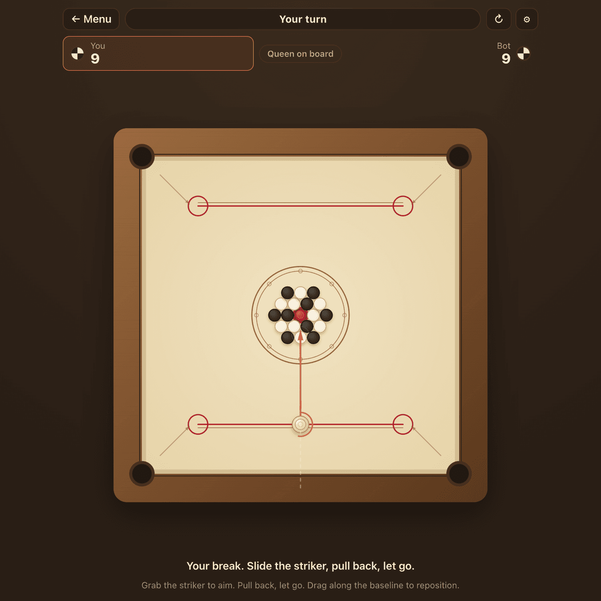
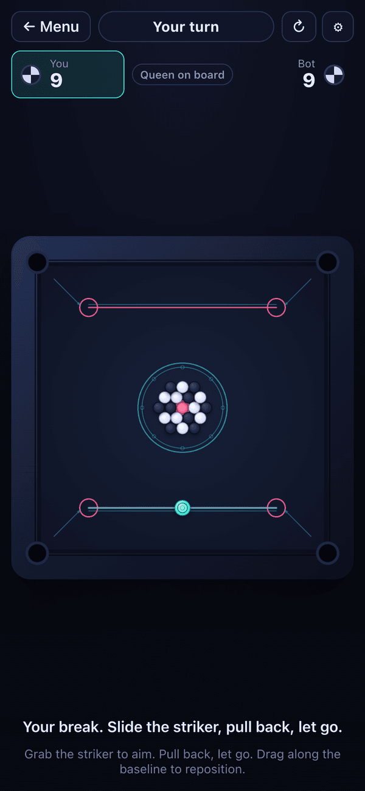

<div align="center">

# CARROMBA

### Carrom, online and instant. Flick, pocket, win. No app, no ads, no signup.

[**Play it now →**](https://carromba.pages.dev/)



</div>

---

Every carrom game on the web lives inside an ad-choked portal or wants you to
install a 200 MB app and make an account. Carromba is the opposite of that. It is
one clean board, real physics, and nothing between you and the flick. Open the
page and you are already playing.

It runs entirely in your browser. No backend, no database, no tracking, no
sign-in. It costs nothing to run and it is free forever, because a game this simple
should not need a business model.

## What you get

- **Physics that feels like a real board.** Pieces slide, clack, bounce off the
  cushions, and coast to a stop the way discs on felt actually do. This is the
  whole point, so it got the most attention.
- **A bot worth beating.** Three difficulties. Easy is a warm-up. Hard lines up
  its shots by simulating them, the same way you would think one through, and it
  does not miss much.
- **Pass and play.** Two people, one device, hand it back and forth.
- **Play online.** Create a private room, send the link, and play a friend live
  from anywhere. Moves sync instantly and it reconnects if someone drops.
- **Themes.** Warm Heritage out of the box (a real wooden board), plus Midnight
  Arcade and Modern Minimal, with the room built in to add more.
- **Plays anywhere.** Desktop and mobile, mouse or touch, one tidy square board.
- **Loads instantly.** The whole thing is around 15 KB of gzipped JavaScript with
  zero runtime dependencies.

<div align="center">

</div>

## How to play

Set the striker anywhere on your baseline, pull back like a slingshot, and let go.
Sink one of your men and you shoot again. Your color is decided the moment you pot
your first piece. Chase the red Queen, but cover her by potting one of your own men
on the same shot or the next one. Clear your men and cover the Queen to take the
board.

The full, unambiguous ruleset is in [RULES.md](RULES.md).

## The physics, briefly

Carromba does not use a physics engine. Carrom is circles sliding on a table with
friction, bouncing off four walls, and dropping into four holes, and that is a
small enough problem to write from scratch and get exactly right.

- **Coulomb friction**, a constant deceleration, so a disc slides and then simply
  stops instead of drifting forever or dying on the spot.
- **Mass-weighted impulse collisions**, so the heavy striker drives through the
  pack instead of pinging off it.
- **Sub-stepped integration** that scales with speed, so a hard flick never tunnels
  through a thin piece.
- **Deterministic**, given the same inputs, which is what lets the bot run a shot
  forward in its head to decide whether to take it.

It lives in [`src/engine`](src/engine) and is covered by unit tests. No frameworks
touch it.

## Playing online

Online games run through a tiny Cloudflare Worker with one Durable Object per
room, living in [`worker/`](worker/). It is a pure relay with a referee: whoever
takes a shot resolves it locally and ships the resulting board, the Worker
forwards that to the opponent and enforces whose turn it is, and the other side
plays the animation and then adopts the authoritative board. Because only one
machine's simulation is ever the truth, the two screens can never quietly drift
apart. Deploy it with `wrangler deploy --config worker/wrangler.jsonc`; it fits
comfortably in Cloudflare's free tier.

## Running it yourself

```bash
npm install
npm run dev        # start the dev server
npm test           # run the engine, rules, and AI tests
npm run build      # type-check and build to dist/
npm run preview    # serve the production build
```

You need Node 20 or newer. That is the whole toolchain.

## How it is put together

```
src/
  engine/   the physics: vectors, bodies, the world, board constants
  game/      the rules: the rack, turn resolution, the striker, the AI, snapshots
  render/    canvas drawing, the themes, the effects
  net/        the online room client (one websocket, seat, reconnect)
  ui/        the screens, the HUD, input, the frame loop
worker/     the online rooms backend (a Worker plus one Durable Object)
```

The `engine` and `game` folders are pure and framework-free, which is why they are
the parts under test. Everything visual reads from a theme object, so a new look is
one more entry in [`src/render/themes.ts`](src/render/themes.ts) and nothing else.

## Tech

TypeScript and Vite, a canvas, and the Web Audio API for the clacks. The game
itself is a folder of static files that will sit happily on any host, with zero
runtime dependencies. The one optional server piece is the online rooms Worker,
which only comes into play when two people want to play over a link.

## Contributing

Issues and pull requests are welcome, especially new themes and anything that makes
the flick feel better. If you touch the engine or the rules, keep the tests green
(`npm test`) and add one for whatever you changed.

## Credit where it is due

Carrom is a public-domain game with centuries of history behind it. Carromba's
board, pieces, physics, and code are all original. No assets or code were taken
from any other carrom project.

## Support

Carromba is free and always will be. If it made your day a little better, you can
[buy me a coffee](https://buymeacoffee.com/winnerkarthik). Entirely optional, much
appreciated.

## License

[MIT](LICENSE). Do what you like with it.
